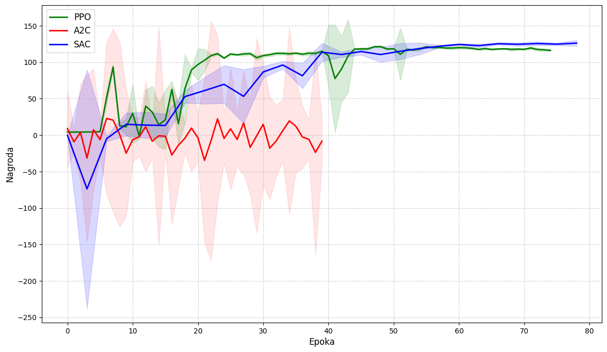
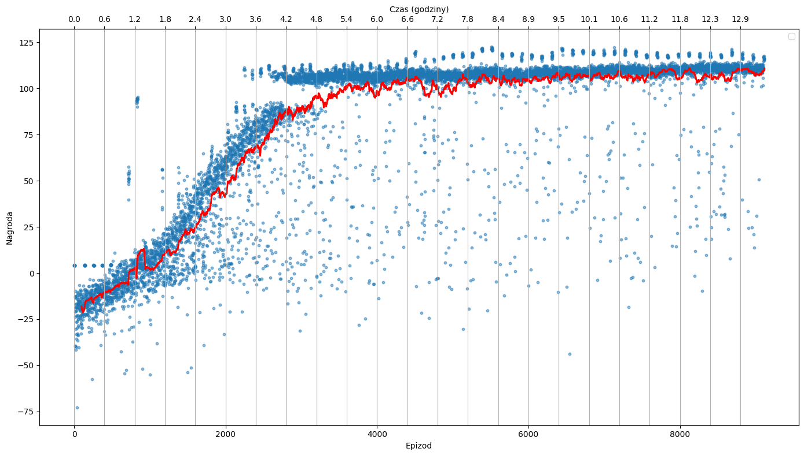

# Quadruped robot locomotion with reinforcement learning

Demo excerpt from my master's thesis (Warsaw University of Technology). A small 8-DOF quadruped robot
(hip + knee per leg) learns to walk in the CoppeliaSim simulator, and the trained policy then runs
on the real robot's Raspberry Pi Pico.

📄 **Full thesis (PDF, in Polish):** [Witold_Pietron_Praca_Magisterska.pdf](Witold_Pietron_Praca_Magisterska.pdf)

## What's inside

- **`CoppeliaSteppingRobotGymEnv`**: a Gymnasium environment that drives the CoppeliaSim scene over the ZeroMQ Remote API
  - 8 continuous actions (target joint angles normalized to [-1, 1])
  - **asymmetric actor-critic observations**: the actor sees only what the real robot can measure (commanded joint positions plus noisy IMU roll/pitch), while the critic also gets privileged simulation state (position, velocity, yaw)
  - shaped reward (forward velocity, body height and tilt, alternating gait, action smoothness) with curriculum learning
  - sim-to-real domain randomization: an IMU bias that stays fixed for each episode, per-step IMU noise, and a randomized initial pose
- **`CustomSeparatePolicy`**: a Stable-Baselines3 policy with separate actor and critic MLPs, plus an exportable actor-only network
- **`ModelTrain.py`**: PPO / A2C / SAC training on 4 parallel simulations, evaluation, and policy export (ONNX and JSON weights for MicroPython `ulab`)
- **`MovementTrajectoryGenerator`** and its notebook: a hand-designed open-loop gait (foot trajectory and leg inverse kinematics) used as a baseline

## Results

<p align="center">
  <br>
  <em>Mean evaluation reward per training epoch (shaded: ±2σ) for PPO, A2C and SAC.</em>
</p>

<p align="center">
  <br>
  <em>Episode rewards during PPO training with a moving average. The top axis shows wall-clock time in hours.</em>
</p>

## Repository structure

```
├── config/
│   └── env_config.example.yaml   # environment parameters (template, values not published)
├── notebooks/
│   ├── ModelPlayground.ipynb               # manual joint commands in the simulator
│   ├── ModelTraining.ipynb                 # training + reward-per-epoch plot
│   └── MovementTrajectoryGeneration.ipynb  # open-loop gait baseline
├── plots/
└── src/
    ├── CoppeliaSteppingRobotGymEnv.py
    ├── CustomSeparatePolicy.py
    ├── LivePlot.py
    ├── ModelTrain.py
    └── MovementTrajectoryGenerator.py
```

## Not included

This repository contains only part of the project. The following are **not** published here:

- CoppeliaSim scene files
- the robot's CAD model
- source code for model inference and robot control on the Raspberry Pi Pico
- the environment parameter values used in the thesis (reward weights, joint limits, curriculum and randomization settings); `config/env_config.example.yaml` lists only their structure

They can be shared on request. Contact: **witek.pietron@gmail.com**

## Usage

Running the code requires the CoppeliaSim scene (see above).

```bash
pip install -r requirements.txt
cp config/env_config.example.yaml config/env_config.yaml   # then fill in the values

# start 4 CoppeliaSim instances with the ZMQ Remote API on ports 23000-23003, then:
cd src
python ModelTrain.py train --algo ppo
python ModelTrain.py evaluate --algo ppo --model ../trained_models/<model>.zip
```
